# SOFTWARE AUDIT — Hind.com
**Audit Date:** 2026-10-26
**Scope:** Complete source-code and configuration inspection of the Hind.com repository at
`c:\Users\ACER\Desktop\LemonIndia-DSC\Lemon Proj\Hind-main`
**Git branch:** `main` (up to date with `origin/main`)
**Auditor:** Static code analysis (automated, no external requests executed)
**Status:** All sections completed based on direct file inspection.

---

## 1. Project Overview

### Name and Purpose
**Hind.com** — marketed as *"Bharat's Search Engine — Fast, Private, Powerful."*
A multi-feature India-focused web portal centred on web, image, video, and news search,
augmented by the **Shrishti AI** assistant, an interactive India map, a weather app,
a translator, a calendar, browser games, and a news reader.

The stated privacy value proposition (from `about.html:423`) is protection from the
tracking associated with mainstream search engines.

### Entry Points
| URL / Path | File | Purpose |
|---|---|---|
| `/` | `index.html` (root) | Instant JS redirect → `Hind-main/index.html` |
| `Hind-main/index.html` | `Hind-main/Hind-main/index.html` | Main homepage |
| `Hind-main/search.html` | `Hind-main/Hind-main/search.html` | Search results |
| `Hind-main/settings.html` | `Hind-main/Hind-main/settings.html` | User settings |
| `Hind-main/about.html` | `Hind-main/Hind-main/about.html` | About / blog (WordPress export) |
| `/api/search` | `api/search.py` | Vercel serverless: all search types |
| `/api/videos` | `api/videos.py` | Vercel serverless: video search |
| `apps/webstore/shrishti/index.html` | — | Shrishti AI standalone page |
| `apps/webstore/news/index.html` | — | Cyan News |
| `apps/webstore/weather/index.html` | — | Weather |
| `apps/webstore/maps/index.html` | — | Cyan Maps |
| `apps/webstore/translator/index.html` | — | Translator |
| `apps/webstore/calendar/index.html` | — | Calendar |
| `apps/webstore/calculator/index.html` | — | Calculator |

### Confirmed Implemented Features
- Web, image, video, and news search (DuckDuckGo via DDGS, server-side)
- Shrishti AI chat (Mistral + OpenRouter, browser-side, cascade fallback)
- AI-enhanced search answer overlay on search results page
- AI image generation (Pollinations AI, browser-side, free)
- Document/file analysis in browser (PDF.js, Mammoth.js)
- Text-to-Speech and Voice Input (Web Speech API)
- Full-site translation (Google Translate unofficial API + MyMemory fallback)
- IP-based automatic language detection
- Dark/Light theme toggle with persistence
- Search autocomplete (Google Suggest JSONP + Wikipedia fallback)
- Local search history (up to 50 entries, `localStorage`)
- Client-side daily AI quota enforcement
- Settings page: profile, preferences, browser permissions display, data export
- Floating inline calculator (homepage and search page)
- Calendar app (events in `localStorage`)
- Weather app (Visual Crossing API, **hardcoded API key**)
- Interactive India map (Leaflet.js + Google/ESRI/OSM tiles)
- News reader (Wikipedia, Hacker News, BBC/ToI RSS via rss2json.com)
- Browser games: Snake, Tic-Tac-Toe, Space Shooter, Minesweeper, Radius Raid

### Incomplete / Under Development
| Item | Evidence |
|---|---|
| `apps/webstore/news/script.js` | Empty file — 0 bytes |
| `apps/webstore/calendar/script.js` | Empty file — 0 bytes |
| `apps/games/xm_future/index.html` | HTML shell only; no game logic |
| `shrishti-engine.js` has Groq and Gemini invokers defined | Functions exist (`callGroq`, `callGemini`) but no active model entry uses them |
| Developer utility scripts in repo | `fix_news.py`, `remove.py` — not deployment code |

---

## 2. Complete Technology Stack

| Category | Technology | Declared Version | Evidence File |
|---|---|---|---|
| Backend runtime | Python | 3.x (cpython-314 pyc observed) | `__pycache__/lgks.cpython-314.pyc` |
| Backend framework (deployed) | `http.server.BaseHTTPRequestHandler` | stdlib | `api/search.py:1` |
| Backend framework (local dev) | FastAPI | unversioned | `requirements.txt`, `lgks.py:1` |
| ASGI server (local dev) | uvicorn | unversioned | `requirements.txt` |
| Search library | DDGS (DuckDuckGo Search) | `>=0.1.0` | `requirements.txt:1` |
| Caching (local dev) | cachetools TTLCache | unversioned | `lgks.py:4,26` |
| Concurrency (local dev) | ThreadPoolExecutor (30 workers) | stdlib | `lgks.py:31` |
| Frontend language | HTML5 + Vanilla JavaScript | — | All HTML files |
| Styling | Vanilla CSS (custom properties) | — | Inline `<style>` blocks |
| CSS framework | Bootstrap | 5.3.0 (CDN) | `index.html:17` |
| Icon library | Font Awesome | 6.4.0 (CDN) | `index.html:18` |
| Typography | Plus Jakarta Sans | — | Google Fonts CDN |
| Typography (news) | Playfair Display | — | Google Fonts CDN |
| PDF parsing | PDF.js | 3.11.174 (CDN) | `index.html:20` |
| DOCX parsing | Mammoth.js | 1.6.0 (CDN) | `index.html:21` |
| DOM utility | jQuery | 3.2.1 (CDN) | `index.html:2017` |
| Maps | Leaflet.js | 1.9.4 (CDN) | `maps/index.html:19,640` |
| AI provider 1 | Mistral AI | `open-mistral-7b` | `shrishti-engine.js:28` |
| AI provider 2 | OpenRouter | `mistralai/mistral-7b-instruct:free` | `shrishti-engine.js:35-36` |
| Image generation | Pollinations AI | free/keyless | `shrishti-engine.js:460` |
| Translation (primary) | Google Translate unofficial API | gtx client | `translate.js:99` |
| Translation (fallback) | MyMemory API | — | `translate.js:112` |
| Weather | Visual Crossing | — | `weather/script.js:85` |
| IP geolocation (translation) | ipapi.co | — | `translate.js:200` |
| IP geolocation (weather) | geolocation-db.com | — | `weather/script.js:66` |
| IP lookup (AI quota) | api.ipify.org | — | `shrishti-engine.js:188` |
| Autocomplete | Google Suggest (JSONP) | — | `index.html:2685` |
| Autocomplete fallback | Wikipedia OpenSearch | — | `index.html:2652` |
| Map tiles | Google Maps (unofficial) | — | `maps/index.html:660,671` |
| Map tiles | ESRI World Imagery | — | `maps/index.html:666` |
| Geocoding | Nominatim (OSM) | — | `maps/index.html:833` |
| News RSS proxy | rss2json.com | — | `news/index.html:979` |
| Speech recognition | Web Speech API | browser-native | `shrishti-engine.js:772` |
| Text-to-speech | Web Speech Synthesis | browser-native | `shrishti-engine.js:727` |
| Deployment | Vercel | v2 | `vercel.json:2` |
| Package manager | pip | — | `requirements.txt` |
| Testing | **None found** | — | — |
| Linting / Type-checking | **None found** | — | — |
| CI/CD | **None found** | — | — |

---

## 3. Repository Structure

```
Hind-main/                          ← Git repository root
├── .gitignore                       ← Ignores __pycache__, *.pyc, keys.txt
├── vercel.json                      ← Vercel v2 config (2 rewrites)
├── requirements.txt                 ← ddgs>=0.1.0, fastapi, cachetools, uvicorn
├── index.html                       ← Root redirect → Hind-main/index.html
├── settings.html                    ← Root redirect → Hind-main/settings.html
├── keys.txt                         ← [LOCAL ONLY, gitignored] previous API keys
├── lgks.py                          ← Full FastAPI server (local dev only)
│
├── api/                             ← Vercel serverless functions (Python)
│   ├── search.py                    ← /api/search: web/images/video/news via DDGS
│   └── videos.py                    ← /api/videos: video-only search via DDGS
│
└── Hind-main/                       ← Main application directory
    ├── LICENSE                      ← GNU GPL v3
    ├── README.md                    ← 3-line description
    ├── vercel.json                  ← Duplicate of root vercel.json
    ├── requirements.txt             ← Duplicate
    ├── lgks.py                      ← Duplicate FastAPI server
    ├── index.html                   ← Homepage (~2,954 lines)
    ├── search.html                  ← Search results (~4,021 lines)
    ├── settings.html                ← Settings/profile (~2,348 lines)
    ├── about.html                   ← About page (WordPress export, ~1,238 lines)
    ├── shrishti-engine.js           ← AI engine: models, quota, TTS, voice, image gen
    ├── translate.js                 ← Full-site translation module
    ├── styles.css                   ← Minimal stub (506 bytes)
    ├── hind.jpg                     ← Logo / brand image
    ├── download.png                 ← Icon asset
    ├── fix_news.py                  ← Developer utility (not deployment code)
    ├── remove.py                    ← Developer utility
    │
    ├── api/                         ← Duplicate of root api/
    │   ├── search.py
    │   └── videos.py
    │
    └── apps/
        ├── gamestore/
        │   └── games.html.html      ← WordPress blog export (game descriptions)
        ├── games/
        │   ├── minesweeper/         ← Minesweeper (multi-file)
        │   ├── radius_raid/         ← Radius Raid (single HTML)
        │   ├── snake/               ← Snake (MIT © Italo Lelis de Carvalho 2018)
        │   ├── space-shooter/       ← Space Shooter (multi-file)
        │   ├── tic-tac-toe/         ← Tic-Tac-Toe (MIT © asymmetric-combination47 2022)
        │   └── xm_future/           ← HTML shell only, no game logic
        └── webstore/
            ├── files.html           ← Static app-store listing page
            ├── calculator/          ← Calculator app (MIT © isomorphic-anomaly84 2022)
            ├── calendar/            ← Calendar app (events in localStorage)
            ├── maps/                ← Cyan Maps (Leaflet + Google/ESRI/OSM + Nominatim)
            ├── news/                ← Cyan News (Wikipedia/HN/BBC/ToI RSS)
            ├── shrishti/            ← Shrishti AI standalone full-page
            ├── translator/          ← Translator (MIT © anomalous-active76 2022)
            └── weather/             ← Weather (Visual Crossing API)
```

> **Duplication note:** `Hind-main/Hind-main/` contains identical copies of `vercel.json`,
> `requirements.txt`, `lgks.py`, and `api/`. The Vercel deployment uses the **root-level**
> `vercel.json` and `api/` directory.

---

## 4. Application Architecture

### Request Flow (Production)

1. Visitor browser loads the root `index.html`.
2. Instant JS redirect: `window.location.replace('Hind-main/index.html')` (`index.html:42`).
3. `Hind-main/index.html` renders the homepage (search box, Shrishti AI panel, calculator).
4. On search submit, browser navigates to `search.html?q=<query>&type=web&page=1`.
5. `search.html` resolves `API_BASE_URL` = `''` (empty string, same-origin) in production (`search.html:2375-2377`).
6. Browser sends `GET /api/search?q=...` to Vercel.
7. Vercel routes `/api/search` → `api/search.py` (Python serverless, no shared state).
8. `api/search.py` queries DuckDuckGo via `ddgs` library and returns JSON.
9. On backend timeout (12 s) or error, `search.html` falls back to direct browser fetches to DuckDuckGo and Wikipedia (`search.html:3200-3203`).
10. AI answers are generated entirely browser-side by `shrishti-engine.js` calling Mistral/OpenRouter directly.

### Execution Environments

| Component | Runs In |
|---|---|
| `index.html`, `search.html`, `settings.html` | Browser |
| `shrishti-engine.js` (all AI, TTS, voice, image gen, doc parse) | Browser |
| `translate.js` | Browser |
| `api/search.py`, `api/videos.py` | Vercel serverless (ephemeral Python) |
| `lgks.py` | Local dev only (FastAPI + uvicorn, **not deployed**) |
| Weather, Maps, Translator, News, Calendar apps | Browser (all external API calls direct from browser) |

### Architecture Diagram

```mermaid
graph TD
    Browser["Browser"]
    Vercel["Vercel Hosting\n(Static HTML/JS/CSS)"]
    VFn["Vercel Serverless\n/api/search.py\n/api/videos.py"]
    DDGS["DuckDuckGo\nDDGS library"]
    Wiki["Wikipedia API"]

    MistralAPI["Mistral AI\napi.mistral.ai"]
    OpenRouter["OpenRouter\nopenrouter.ai"]
    Pollinations["Pollinations AI\nimage.pollinations.ai"]
    GTrans["Google Translate\ntranslate.googleapis.com"]
    MyMemory["MyMemory\napi.mymemory.translated.net"]
    GSuggest["Google Suggest\nsuggestqueries.google.com"]
    VisualX["Visual Crossing\nweather.visualcrossing.com"]
    GeoDBCom["geolocation-db.com"]
    IPApiCo["ipapi.co"]
    IPIfy["api.ipify.org"]
    LeafletTiles["Map Tiles\nGoogle / ESRI / OSM"]
    Nominatim["Nominatim OSM"]
    RSS2J["rss2json.com\nRSS Proxy"]
    HNAPI["Hacker News API"]
    CDNs["CDNs\nBootstrap, FA, PDF.js,\nMammoth, jQuery, Leaflet"]

    Browser --> Vercel
    Browser -->|GET /api/search| VFn
    Browser -->|GET /api/videos| VFn
    VFn --> DDGS
    VFn --> Wiki

    Browser -->|AI chat direct| MistralAPI
    Browser -->|AI fallback direct| OpenRouter
    Browser -->|Image gen direct| Pollinations
    Browser -->|Page translation| GTrans
    Browser -->|Translation fallback| MyMemory
    Browser -->|Autocomplete JSONP| GSuggest
    Browser -->|Autocomplete fallback| Wiki
    Browser -->|Weather| VisualX
    Browser -->|IP for weather| GeoDBCom
    Browser -->|IP for language| IPApiCo
    Browser -->|IP for AI quota| IPIfy
    Browser -->|Map tiles| LeafletTiles
    Browser -->|Geocoding| Nominatim
    Browser -->|RSS proxy| RSS2J
    Browser -->|News fallback| HNAPI
    Browser -->|CDN scripts| CDNs
```



---

## 5. Feature Inventory

| Feature | Status | Key Files | Notes |
|---|---|---|---|
| Web search | ✅ Implemented | `api/search.py:51`, `search.html:3092` | DDGS + Wikipedia fallback |
| Image search | ✅ Implemented | `api/search.py:70`, `search.html:3140` | DDGS |
| Video search | ✅ Implemented | `api/videos.py`, `api/search.py:7` | DDGS; both endpoints overlap |
| News search | ✅ Implemented | `api/search.py:86`, `search.html:3176` | DDGS |
| "All" combined | ✅ Implemented | `api/search.py:164` | Sequential (not concurrent) in Vercel handler |
| Pagination | ✅ Implemented | `search.html:3194`, `api/search.py:121` | Max 50 pages hardcoded |
| Search suggestions | ✅ Implemented | `index.html:2590` | Google JSONP → Wikipedia fallback |
| Local search history | ✅ Implemented | `index.html:2592`, `settings.html:1631` | 50 entries, `localStorage` |
| Shrishti AI chat | ✅ Implemented | `shrishti-engine.js`, `index.html:2157` | Browser-side, Mistral + OpenRouter |
| AI search answers | ✅ Implemented | `search.html:3207` | 30/day per IP (client-side) |
| AI image generation | ✅ Implemented | `shrishti-engine.js:448` | Pollinations AI, 2 Pro Credits |
| Document analysis | ✅ Implemented | `shrishti-engine.js:483` | PDF/DOCX/TXT/VTT/SRT, 5 Pro Credits |
| Text-to-speech | ✅ Implemented | `shrishti-engine.js:703` | Web Speech Synthesis API |
| Voice input | ✅ Implemented | `shrishti-engine.js:769` | Web Speech Recognition, `en-IN` |
| Full-site translation | ✅ Implemented | `translate.js` | 45+ languages, IP-based default |
| Standalone translator | ✅ Implemented | `apps/webstore/translator/script.js` | MyMemory + Google fallback |
| Theme switching | ✅ Implemented | `index.html:2020` | `localStorage` key `hind_theme` |
| Settings page | ✅ Implemented | `settings.html` | Profile, history, quota, permissions |
| Floating calculator | ✅ Implemented | `index.html:2058` | Embedded in homepage & search page |
| Standalone calculator | ✅ Implemented | `apps/webstore/calculator/` | MIT-licensed third-party |
| Calendar | ✅ Implemented | `apps/webstore/calendar/index.html` | Events in `localStorage` |
| Weather | ✅ Implemented (key risk) | `apps/webstore/weather/script.js` | Visual Crossing, hardcoded API key |
| Maps | ✅ Implemented | `apps/webstore/maps/index.html` | Leaflet + unofficial Google tiles |
| News (Cyan News) | ✅ Implemented | `apps/webstore/news/index.html` | Multi-tier: Wikipedia → HN → RSS |
| Games | ✅ Implemented | `apps/games/` | Snake, TTT, Space Shooter, Minesweeper |
| xm_future game | ⚠️ Incomplete | `apps/games/xm_future/index.html` | HTML only, no logic |
| BYOK (user API keys) | ❌ Not implemented | — | Keys are hardcoded in JS |
| Multi-turn AI conversation | ❌ Not implemented | — | Each prompt is single-turn |
| Server-side user accounts | ❌ Not implemented | — | No auth, no backend DB |

---

## 6. Search Engine Audit

### Provider
**DuckDuckGo** via the `ddgs` Python library (`requirements.txt:1`). All four search
types (web, images, videos, news) use DDGS.

### Request Origin
Search requests are **server-side** (Vercel Python function). The browser sends a
`fetch()` to `/api/search`; the function queries DuckDuckGo. DuckDuckGo never sees the
end-user's IP in the primary path.

**Exception — fallback path:** If the backend times out (12 s, `search.html:3121`) or
errors, `performFallbackSearch()` makes **direct browser-to-DuckDuckGo** requests
(`search.html:2971`), so the user's IP **is** then visible to DuckDuckGo.

### Endpoints

**`GET /api/search`** (`api/search.py`)
- Parameters: `q` (required), `type` (default `web`), `page` (default 1), `limit` (default 25)
- Validation: empty `q` → 400. **No upper bound enforced on `limit` in the Vercel handler.**
- CORS: `Access-Control-Allow-Origin: *` (`api/search.py:116,199`)

**`GET /api/videos`** (`api/videos.py`)
- Same parameters and validation as above.
- The frontend always calls `/api/videos` for video type (`search.html:3116-3117`),
  making the video branch of `/api/search` effectively redundant in production.

### Pagination
- Default page size: 25 results
- Maximum pages: hardcoded `total_pages: 50`
- `has_next` is `true` when result count ≥ `limit` and `page < 50`

### Caching
- **Vercel handlers (`api/search.py`, `api/videos.py`):** No caching. Every request is a live DDGS call.
- **Local `lgks.py`:** TTLCache, 300-second TTL, 10,000-entry max (`lgks.py:26-29`). Not deployed to Vercel.

### Timeouts
- DDGS web: 8 s (`api/search.py:54`); images/news: 8 s; videos: 10 s (`api/search.py:12`).
- Client-side: 12 s (`search.html:3121`).

### Rate Limiting
**None** in either Vercel handler.

### Result Deduplication
- Web and video results: URL-based `seen` set (`api/search.py:56-59`, `14-19`).
- Images and news: no explicit deduplication in Vercel handler.

### Logging
No explicit query logging in `api/search.py` or `api/videos.py`. Vercel's platform
may log request paths (including query strings). **Requires Vercel dashboard verification.**

### Representative Trace: `GET /api/search?q=india+cricket&type=news&page=1&limit=25`
1. Browser builds URL using `API_BASE_URL = ''` → same-origin fetch.
2. Vercel routes to `api/search.py`.
3. `get_news('india cricket', 1, 25)` → `DDGS(timeout=8).news(...)`.
4. Results serialised to JSON with pagination metadata.
5. Response: `200 OK`, `Content-Type: application/json`, `Access-Control-Allow-Origin: *`.
6. `search.html` calls `renderNewsResults(items, trimmed)`.

---

## 7. AI and Assistant Integration

### Active Models

| Internal Name | Provider | Model ID | Key Location |
|---|---|---|---|
| `lemon-pineapple-a` | Mistral AI | `open-mistral-7b` | `shrishti-engine.js:27` (hardcoded) |
| `cyan-hind-b` | OpenRouter | `mistralai/mistral-7b-instruct:free` | `shrishti-engine.js:35` (hardcoded) |

> ⚠️ **Both keys are hardcoded in client-side JavaScript visible to every site visitor.**
> See §14 (Security) for full findings.

### Defined but Inactive
- `callGroq()` — `shrishti-engine.js:339`: function defined, no active model entry.
- `callGemini()` — `shrishti-engine.js:307`: function defined, no active model entry.

### API Call Mechanism
All AI calls originate **in the browser** via `fetch()`. Hind.com's backend is not
involved. The prompt goes directly from the user's browser to the AI provider.

- OpenRouter: `POST https://openrouter.ai/api/v1/chat/completions` (`shrishti-engine.js:277`)
- Mistral: `POST https://api.mistral.ai/v1/chat/completions` (`shrishti-engine.js:375`)

### Cascade / Cushion Logic (`shrishti-engine.js:404`)
1. Try primary model.
2. On any exception or empty response → log warning → try next model in `DEFAULT_ORDER`.
3. All models fail → throw error listing all failure messages.

### Prompt Construction
- Standard: fixed system message + single user message (no conversation history).
- File analysis: structured system prompt + up to 4,000 characters of file content
  (`shrishti-engine.js:646,653-667`).
- **No multi-turn history is maintained or transmitted.**

### Response Format
Non-streaming (`fetch().then(res.json())`). UI shows a typing-dot animation while waiting.
35-second `AbortController` timeout per call (`shrishti-engine.js:275`).

### Quotas (Client-Side `localStorage` Only)
| Quota | Limit | Storage Key | Reset |
|---|---|---|---|
| Standard AI queries | 15/day | `shrishti_daily_quota` | Date change |
| AI search answers | 30/day/IP | `shrishti_search_quota_<ip>_<date>` | Date change |
| Pro Credits | 10/day | `shrishti_pro_credits` | Date change |
| Image generation | 2 credits each | — | — |
| File analysis | 5 credits each | — | — |

All quotas are trivially bypassable by clearing `localStorage`.

### Image Generation (`shrishti-engine.js:448`)
- Provider: Pollinations AI (`https://image.pollinations.ai/prompt/...`), no API key required.
- Prompt sanitized with `/[^\w\s,.-]/gi` → space.
- Random seed appended.
- 2 Pro Credits deducted on success.

### Document Analysis (`shrishti-engine.js:483`)
- Supported: PDF (up to 15 pages via PDF.js), DOCX/DOC (Mammoth.js), TXT, VTT, SRT.
- Content truncated to 4,000 characters before sending to AI.
- 5 Pro Credits deducted on success.

### Speech (`shrishti-engine.js:686-843`)
- TTS: `SpeechSynthesisUtterance`; detects Hindi Unicode range → `hi-IN`, else `en-US`.
- STT: `SpeechRecognition`, `lang = 'en-IN'`, `continuous = false`, `interimResults = true`.
- No audio data transmitted by application code to external servers.

### Conversation Persistence
**None.** Chat messages are DOM-only; they disappear on page reload.

### BYOK
**Not implemented.** No UI or mechanism for users to supply their own API keys.

### External Data Sent to AI Providers (per request)
- User prompt text
- System message string (identifies Hind.com)
- For file analysis: up to 4,000 characters of file content
- HTTP headers: hardcoded API key, `HTTP-Referer: https://hind.com`, `X-Title: Hind Search Engine`
- Provider data-retention policies: **Requires external verification.**

---

## 8. API Endpoint Inventory

| Endpoint | Method | File | Purpose | Input | Validation | Output | External | Auth | Rate Limit | Concerns |
|---|---|---|---|---|---|---|---|---|---|---|
| `/api/search` | GET | `api/search.py` | All search types | `q`, `type`, `page`, `limit` | Empty `q` → 400 | JSON + pagination | DDGS, Wikipedia | None | None | No `limit` cap; wildcard CORS |
| `/api/videos` | GET | `api/videos.py` | Video search | `q`, `page`, `limit` | Empty `q` → 400 | JSON + pagination | DDGS | None | None | Same as above |
| `/api/search` | OPTIONS | `api/search.py:205` | CORS preflight | — | — | CORS headers | None | None | — | `Allow-Headers: *` |
| `/api/videos` | OPTIONS | `api/videos.py:98` | CORS preflight | — | — | CORS headers | None | None | — | `Allow-Headers: *` |
| `/api/search` (FastAPI) | GET | `lgks.py:267` | Same + caching | Same; `page` and `limit` capped at 50 | FastAPI validation | Same JSON | DDGS + Wikipedia | None | None | **Local dev only, not deployed** |
| `/api/autocomplete` | GET | `lgks.py:398` | Search suggestions | `q` | None | JSON string array | Google Suggest | None | None | **Local dev only, not deployed** |
| `/` | GET | `lgks.py:414` | Health check | — | — | JSON status | None | None | — | **Local dev only** |

---

## 9. External Services and Third-Party Integrations

| Provider | Hostname | Purpose | Files | Data Sent | Origin | Active |
|---|---|---|---|---|---|---|
| DuckDuckGo (DDGS) | `duckduckgo.com` (internal) | All search | `api/search.py`, `api/videos.py` | Query, page, limit | Server | ✅ |
| Mistral AI | `api.mistral.ai` | AI chat (primary) | `shrishti-engine.js:375` | Prompt, hardcoded API key | Browser | ✅ |
| OpenRouter | `openrouter.ai` | AI chat (fallback) | `shrishti-engine.js:277` | Prompt, hardcoded API key, Referer | Browser | ✅ |
| Pollinations AI | `image.pollinations.ai` | Image generation | `shrishti-engine.js:460` | Text prompt | Browser | ✅ |
| Google Translate (unofficial) | `translate.googleapis.com` | Page translation | `translate.js:99` | Page text segments | Browser | ✅ |
| MyMemory | `api.mymemory.translated.net` | Translation fallback | `translate.js:112`, `translator/script.js:39` | Text | Browser | ✅ |
| Google Suggest | `suggestqueries.google.com` | Autocomplete (JSONP) | `index.html:2685` | Partial query | Browser | ✅ |
| Wikipedia API | `en.wikipedia.org` | Search fallback + autocomplete | `lgks.py:62`, `index.html:2652` | Query | Both | ✅ |
| Visual Crossing | `weather.visualcrossing.com` | Weather data | `weather/script.js:85` | City name + **hardcoded API key** | Browser | ✅ |
| geolocation-db.com | `geolocation-db.com` | IP geolocation (weather) | `weather/script.js:66` | IP (implicit) | Browser | ✅ |
| ipapi.co | `ipapi.co` | Language detection | `translate.js:200` | IP (implicit) | Browser | ✅ |
| api.ipify.org | `api.ipify.org` | Get client IP for AI quota | `shrishti-engine.js:188` | IP (implicit) | Browser | ✅ |
| Leaflet (unpkg) | `unpkg.com` | Map library | `maps/index.html:19,640` | None | Browser | ✅ |
| Google Maps tiles (unofficial) | `mt0-3.google.com` | Satellite/Street tiles | `maps/index.html:660,671` | Tile coords | Browser | ✅ |
| ESRI World Imagery | `server.arcgisonline.com` | Satellite tiles | `maps/index.html:666` | Tile coords | Browser | ✅ |
| Nominatim OSM | `nominatim.openstreetmap.org` | Map geocoding | `maps/index.html:833` | Search query | Browser | ✅ |
| rss2json.com | `api.rss2json.com` | RSS proxy | `news/index.html:979` | RSS feed URL | Browser | ✅ |
| BBC News RSS | `feeds.bbci.co.uk` | News | `news/index.html:973` | None | Browser | ✅ |
| Times of India RSS | `timesofindia.indiatimes.com` | News | `news/index.html:974` | None | Browser | ✅ |
| Hacker News API | `hacker-news.firebaseio.com` | News fallback | `news/index.html:944` | None | Browser | ✅ |
| Google Fonts | `fonts.googleapis.com` | Typography | All major HTML files | Referer header | Browser | ✅ |
| Bootstrap (jsDelivr) | `cdn.jsdelivr.net` | CSS framework | Multiple HTML files | None | Browser | ✅ |
| Font Awesome (cdnjs) | `cdnjs.cloudflare.com` | Icons | Multiple HTML files | None | Browser | ✅ |
| PDF.js (cdnjs) | `cdnjs.cloudflare.com` | PDF parse | `index.html:20` | None | Browser | ✅ |
| Mammoth.js (cdnjs) | `cdnjs.cloudflare.com` | DOCX parse | `index.html:21` | None | Browser | ✅ |
| jQuery (cdnjs) | `cdnjs.cloudflare.com` | DOM utility | `index.html:2017` | None | Browser | ✅ |
| DuckDuckGo (fallback) | `api.duckduckgo.com` | Instant answers | `search.html:2971` | Query | Browser | ✅ (fallback) |
| WordPress analytics | `stats.wp.com`, `s2.wp.com`, `s0.wp.com`, `0.gravatar.com`, `ced.sascdn.com` | Analytics + ads | `about.html`, `games.html.html` | Page metadata | Browser | ⚠️ (exported pages only) |

---

## 10. Privacy and Data-Flow Audit

### Search Queries
| Point | Data | Storage | Retention |
|---|---|---|---|
| Browser → `/api/search` | Query string in HTTP request | Vercel server logs (platform-managed) | Unknown — requires Vercel verification |
| Browser → `localStorage` (`hind_search_history`) | Up to 50 queries with timestamps | Browser | Until user clears or app resets |
| Browser → DuckDuckGo (fallback) | Full query | DuckDuckGo servers | DuckDuckGo's own policy |
| Browser → Google Suggest (JSONP) | Partial query characters | Google servers | Google's own policy |

### AI Prompts and Responses
- Transmitted **directly from the browser** to Mistral AI and OpenRouter.
- **Not routed through Hind.com servers.**
- File content (up to 4,000 chars) also transmitted if user attaches a file.
- Provider data retention: **Requires external verification.**

### IP Addresses
- Exposed to Vercel (search requests carry user's IP).
- Exposed to: `api.ipify.org`, `ipapi.co`, `geolocation-db.com` (each fetched from browser).
- Exposed to Mistral AI and OpenRouter when AI is used.
- Exposed to all CDN providers (Bootstrap, Google Fonts, etc.).
- Cached in `sessionStorage` key `hind_client_ip` (`shrishti-engine.js:194`).

### Cookies
- **No application-managed cookies** found in Hind.com source files.
- WordPress exported pages (`about.html`, `games.html.html`) set `wordpress_com_login_access=denied` (1-year cookie, `about.html:86`).
- Hosting and CDN cookies are outside application code visibility.

### localStorage Keys (All Application-Managed)

| Key | Purpose | Cleared by |
|---|---|---|
| `hind_theme` | Dark/light preference | Settings "Reset All" |
| `hind_search_history` | Recent queries (max 50) | Settings "Clear History" / "Reset All" |
| `hind_user_profile` | Name, email, bio, avatar | Settings "Reset All" |
| `hind_user_preferences` | Suggest / save-history toggles | Settings "Reset All" |
| `shrishti_daily_quota` | AI query count + date | Auto-reset next day |
| `shrishti_pro_credits` | Pro credits used + date | Auto-reset next day |
| `cyan_calendar_events` | Calendar events JSON | **Not cleared by any settings action** |
| `hind_permissions` | Permission toggle state | **Not cleared by any settings action** |
| `hind_user_lang` | User-chosen language | **Not cleared by any settings action** |
| `hind_ip_default_lang` | IP-detected default language | **Not cleared by any settings action** |
| `hind_anon_ip_id` | Pseudo-anonymous device ID for quota | **Not cleared by any settings action** |
| `shrishti_search_quota_<ip>_<date>` | Per-IP search AI quota | Auto-reset next day |

### sessionStorage Keys

| Key | Purpose | Cleared |
|---|---|---|
| `hind_client_ip` | Cached IP from ipify.org | Session end |
| `hind_translated_<pathname>` | Per-page translation flag | Session end |

### Geolocation
Browser geolocation (`navigator.geolocation`) is listed in `settings.html` permission controls,
but **no active application code was found that requests or uses GPS geolocation**.
IP-based geolocation (coarser) is used via `geolocation-db.com` and `ipapi.co`.

### Audio Data
Speech recognition is processed by the browser's built-in engine. Application code does
not transmit audio to external servers. Whether the browser/OS sends audio to a
platform-level service depends on the user's device and browser.

### User Accounts / Authentication
**None.** The `hind_user_profile` object stores name, email, and bio locally in the browser.
This data does not leave the browser via any application code path.

### Analytics
No Hind.com-owned analytics platform detected in the main application pages.
WordPress.com analytics (`stats.wp.com/w.js`) present in `about.html` and `games.html.html`.

---

## 11. Storage, Cookies, and Persistence

| Mechanism | Scope | Contents | App-managed | Max Lifetime |
|---|---|---|---|---|
| `localStorage` | Per-origin, persistent | Preferences, history, quota, profile, calendar, device ID | Yes | Until cleared |
| `sessionStorage` | Per-origin, per-tab | Cached IP, translation state | Yes | Tab close |
| IndexedDB | — | None found | — | — |
| Cookies (app) | — | None set by app | — | — |
| Cookies (WordPress pages) | Per-origin | `wordpress_com_login_access` | No (WordPress) | 1 year |
| Service Workers | — | None found | — | — |
| Backend DB | — | None | — | — |

**Incomplete clear:** The Settings "Reset All" function deletes `hind_user_profile`,
`hind_search_history`, and `hind_user_preferences` (`settings.html:2029-2031`) but
does **not** clear `cyan_calendar_events`, `hind_anon_ip_id`, `hind_user_lang`,
`hind_ip_default_lang`, or `hind_permissions`.

---

## 12. Hosting and Deployment

**Platform:** Vercel (v2, confirmed by `vercel.json`).

### Confirmed from Repository (`vercel.json`)
```json
{
  "version": 2,
  "rewrites": [
    { "source": "/api/videos", "destination": "/api/videos.py" },
    { "source": "/api/search",  "destination": "/api/search.py"  }
  ]
}
```

- Two URL rewrites: `/api/search` → `api/search.py`, `/api/videos` → `api/videos.py`.
- No `build` command, `output` directory, `installCommand`, or `functions` config specified.
  Vercel auto-detects static serving + Python serverless.
- **Python runtime version not specified** — Vercel selects a default. Requires dashboard verification.
- **No function timeout or memory limits** configured — Vercel defaults apply
  (10 s on Hobby, 60 s on Pro).
- **No security headers** configured in `vercel.json`.
- **No CORS configuration** in `vercel.json` — handled per-handler with `Access-Control-Allow-Origin: *`.
- No edge functions, scheduled jobs, or preview deploy configuration.
- Deployment URL referenced in `about.html:427`: `https://hind-com.vercel.app`
  (link text says `https://xmshind.vercel.app` — possibly outdated).

### Requires Vercel Dashboard Verification
- Actual Python runtime version in production.
- Environment variable configuration (AI keys, if any).
- Function timeout and memory settings.
- Custom domain bindings.
- Analytics or monitoring settings.
- Access log retention.

### Duplication Concern
`Hind-main/Hind-main/vercel.json` is identical to root `vercel.json`. If Vercel ever
uses the nested copy instead of the root, routing may misbehave.

---

## 13. Environment Variables and Secrets

### Variables Referenced by Application Code
None found. The application reads no `process.env` or environment variable at runtime.
All sensitive values are hardcoded in source files.

### Hardcoded Credentials (Variable Names Only — Values Not Reproduced)

| Service | Type | File | Line |
|---|---|---|---|
| Mistral AI | API key (`apiKey` property) | `shrishti-engine.js` | 27 |
| OpenRouter | API key (`apiKey` property) | `shrishti-engine.js` | 35 |
| Visual Crossing | API key (URL query parameter `key=`) | `apps/webstore/weather/script.js` | 85 |

### Historical Credentials in Git History
`git log -S "gsk_"` found commits `9352d89` and `479f12f` which contain a Groq API key
that was previously embedded in `shrishti-engine.js`. This key and any other previously
committed credentials must be considered **compromised** and rotated immediately.

The local `keys.txt` lists four providers (Groq, Google Gemini, OpenRouter, Mistral)
with their respective keys. This file is correctly gitignored. However, the file's own
header notes keys were "previously embedded in `shrishti-engine.js`" — the current
Mistral and OpenRouter keys in `shrishti-engine.js` remain embedded.

---

## 14. Security Audit

### CRITICAL — Hardcoded API Keys in Client-Side JavaScript
**Severity:** Critical
**Evidence:** `shrishti-engine.js:27` (Mistral), `shrishti-engine.js:35` (OpenRouter),
`weather/script.js:85` (Visual Crossing).
**Conditions to exploit:** Open browser DevTools → Sources. Keys are plain text.
**Impact:** Unrestricted third-party use of the project's API accounts; financial cost;
potential account suspension.
**Remediation:** Remove keys from JS. Create a Vercel serverless function that reads the
key from a Vercel environment variable and proxies AI requests. The browser calls the
Hind.com proxy, never the AI provider directly.

---

### HIGH — Previously Committed Secrets in Git History
**Severity:** High
**Evidence:** Commits `9352d89` and `479f12f` contain a Groq API key.
**Conditions:** Anyone who clones the repo or browses GitHub history can extract the key.
**Remediation:** Rotate all listed provider keys immediately. Purge history with
`git filter-repo` or BFG Repo Cleaner. Treat all keys in `keys.txt` as compromised.

---

### HIGH — No Rate Limiting on Serverless Search Endpoints
**Severity:** High
**Evidence:** `api/search.py` and `api/videos.py` contain no rate-limiting logic.
**Impact:** Unlimited DDGS calls possible; DDGS IP ban risk; unbounded Vercel function
invocation cost.
**Remediation:** Add rate limiting at the Vercel edge (Edge Config or KV-based counter)
or within the handler. Restrict CORS origin to Hind.com domain.

---

### HIGH — No `limit` Upper Bound in Vercel Handlers
**Severity:** High
**Evidence:** `api/search.py:111`: `limit = int(params.get('limit', ['25'])[0])` — no cap.
**Impact:** `?limit=10000` forces DDGS to attempt massive result sets → latency, memory,
cost.
**Remediation:** Add `limit = min(max(1, limit), 50)`. (The `lgks.py` FastAPI version
already enforces `le=50` at line 272.)

---

### HIGH — Wildcard CORS on All API Endpoints
**Severity:** Medium-High
**Evidence:** `api/search.py:116,199`, `api/videos.py:18,93`.
**Impact:** Any website can call the project's search endpoints cross-origin, consuming
DDGS quota.
**Remediation:** Set `Access-Control-Allow-Origin` to the production domain only.

---

### MEDIUM — No Type Allowlist on `type` Parameter
**Severity:** Medium
**Evidence:** `api/search.py:109` — `search_type` accepted as-is; unknown types fall to
`else` (web search). No injection risk found, but not allowlisted.
**Remediation:** Validate `search_type in {'web','images','videos','news','all'}`.

---

### MEDIUM — Visual Crossing API Key Publicly Exposed
**Severity:** Medium
**Evidence:** `weather/script.js:85`.
**Impact:** Third parties can consume the weather API quota at the project's expense.
**Remediation:** Proxy weather requests through a Vercel function.

---

### MEDIUM — No Subresource Integrity (SRI) on CDN Scripts
**Severity:** Medium
**Evidence:** None of the CDN `<script>` or `<link>` tags in inspected HTML files include
`integrity=` attributes.
**Impact:** CDN compromise → arbitrary code execution in visitors' browsers.
**Remediation:** Add SRI hashes (sha256/sha384) to all CDN resource tags.

---

### MEDIUM — Google Maps Tiles Used Without Official Licence
**Severity:** Medium (terms-of-service)
**Evidence:** `maps/index.html:660,671` — tiles fetched from `mt{s}.google.com/vt/...`.
**Impact:** Google may block tile requests; ToS violation.
**Remediation:** Use an official Google Maps API key with billing, or switch to OSM tiles.

---

### LOW — AI Quota Bypass via `localStorage` Clear
**Severity:** Low (intentional design limitation)
All quotas are `localStorage`-based. Users can clear storage to reset counters.

---

### LOW — Silent Exception Swallowing in Python Handlers
**Severity:** Low
**Evidence:** `api/search.py:66,83,99`: `except Exception: pass`.
**Impact:** Errors are invisible in production; debugging is blind.
**Remediation:** Log exceptions (e.g. `print(traceback.format_exc())` captured by Vercel).

---

### LOW — Personal Contact Details in `about.html`
**Severity:** Low
**Evidence:** `about.html:453,457` — developer email and phone number.
**Impact:** PII publicly visible; potential harassment risk.
**Remediation:** Remove or anonymise.

---

### NOT FOUND (Verified Absence)
- No SQL queries → no SQL injection risk.
- No server-side file uploads.
- No `eval()` or unescaped `innerHTML` with user input (search results consistently use
  `escapeHtml()`, defined at `search.html:2384`).
- No open redirects in Hind.com code.
- No obvious XSS vectors in search rendering.

---

## 15. Dependencies and Supply Chain

### Python (`requirements.txt`)

| Package | Declared Version | Purpose | Notes |
|---|---|---|---|
| `ddgs` | `>=0.1.0` | DuckDuckGo search | No upper bound; any version may install |
| `fastapi` | unversioned | Local dev API framework | Not deployed to Vercel |
| `cachetools` | unversioned | TTL cache in `lgks.py` | Not deployed to Vercel |
| `uvicorn` | unversioned | ASGI server (local dev) | Not deployed to Vercel |

**No lockfile found.** No `requirements.lock`, `Pipfile.lock`, or `pyproject.toml` exists.
Builds are not reproducible.

### JavaScript (CDN — No Package Manager)

| Library | Version | CDN |
|---|---|---|
| Bootstrap CSS | 5.3.0 | jsDelivr |
| Font Awesome | 6.4.0 | cdnjs |
| jQuery | **3.2.1** (2017) | cdnjs |
| PDF.js | 3.11.174 | cdnjs |
| Mammoth.js | 1.6.0 | cdnjs |
| Leaflet.js | 1.9.4 | unpkg |

No `package.json`. All JS loaded at runtime from CDN. No SRI verification.
**jQuery 3.2.1 is significantly outdated** (current stable: 3.7.x).

---

## 16. Software Licence and Copyright Inventory

| File / Directory | Licence | Copyright Holder |
|---|---|---|
| `Hind-main/Hind-main/LICENSE` | **GNU GPL v3** | *Not specified in file* |
| `Xm-weather--main/LICENSE` | GNU GPL v3 | *Not specified* |
| `Xm-Calculator--main/LICENSE` | MIT | Lemon India.llc (2023) |
| `Xm-Calendar--main/LICENSE` | MIT | Lemon-India (2023) |
| `Xm-Translate-main/LICENSE` | MIT | Lemon India.llc (2024) |
| `Xm-news-main/LICENSE` | Boost Software License 1.0 | *Not specified* |
| `apps/games/snake/LICENSE` | MIT | Italo Lelis de Carvalho (2018) |
| `apps/games/tic-tac-toe/LICENSE` | MIT | asymmetric-combination47 (2022) |
| `apps/webstore/calculator/LICENSE` | MIT | isomorphic-anomaly84 (2022) |
| `apps/webstore/translator/LICENSE` | MIT | anomalous-active76 (2022) |

### Licence Concerns
1. **GPL v3 with no copyright attribution:** The root `LICENSE` file contains GPL v3 text
   but no copyright owner or year for Hind.com's original code.
2. **GPL v3 + MIT mix:** MIT-licensed components (calculator, translator, games) can be
   included in a GPL v3 project. The combined work must comply with GPL v3.
3. **Unofficial Google Maps tiles:** Using Google's tile servers without an API key likely
   violates Google Maps' Terms of Service.
4. **`india-boundary.js` source unknown:** Copyright and licence of the GeoJSON boundary
   data are not documented.
5. **WordPress export code:** `about.html` and `games.html.html` contain WordPress.com
   theme/plugin code owned by Automattic.

---

## 17. Branding and Intellectual Property

| Asset | Type | Evidence | Notes |
|---|---|---|---|
| "Hind.com" | Product name | Titles, README | No trademark registration evidence |
| "Bharat's Search Engine" | Tagline | `README.md`, `index.html` | — |
| "Lemon India" / "Lemon India.llc" | Organisation name | MIT licence files | Legal entity status unknown |
| "Shrishti AI" | AI product name | `shrishti-engine.js`, app title | — |
| "Cyan News", "Cyan Maps", "Cyan Calendar" | Sub-product names | App HTML titles | — |
| "Lemon Pineapple a", "Cyan Hind b" | Internal AI model names | `shrishti-engine.js:22,30` | — |
| `hind.jpg` | Logo image | `Hind-main/Hind-main/hind.jpg` | Source / copyright unknown |
| "VandeMataram Jai Hind" | Slogan | `about.html:7` | — |
| Developer: "Sourab" | Personal attribution | `about.html:453` | Age 17 at writing; email/phone exposed |
| "XM" prefix | Sub-brand | Xm-* directory names | — |

**Third-party trademarks visible in UI:** DuckDuckGo (undisclosed), Mistral, OpenRouter,
© Google Maps (tile attribution), YouTube (video thumbnails).

---

## 18. Accessibility and User Experience

### Implemented
- `lang="en"` on `<html>` elements.
- `meta name="viewport"` for mobile responsiveness.
- CSS custom properties enabling dark/light theme for all major pages.
- `placeholder` attributes on inputs; `title` attributes on icon buttons.
- Loading skeleton states before search results render.
- Error states displayed in search result container.
- Keyboard `Enter` triggers search.
- Responsive `@media` breakpoints (translation widget, general layouts).
- `aria-label` on some icon buttons in maps (`maps/index.html:various`).

### Identified Gaps
- `alt=""` (empty) on logo/blog images (`about.html:407`). Descriptive alt text absent.
- No ARIA roles on custom interactive widgets (calculator panel, AI panel, suggestion dropdown).
- No skip-navigation link.
- Search inputs use `placeholder` only — no explicit `<label>` association.
- Focus management not implemented when floating panels open/close.
- `prefers-reduced-motion` media query not found in inspected CSS.
- No formal accessibility testing evidence found.
- Contrast ratios: **Requires visual or automated tooling verification.**

---

## 19. Performance and Resource Usage

### File Sizes
| File | Size |
|---|---|
| `search.html` | 138,814 bytes (~136 KB) |
| `about.html` | 117,277 bytes (~115 KB) |
| `index.html` | 96,490 bytes (~94 KB) |
| `settings.html` | 72,072 bytes (~70 KB) |
| `weather/script.js` | 54,615 bytes (~53 KB) |
| `shrishti-engine.js` | 32,011 bytes (~31 KB) |

### Performance Concerns
- **PDF.js and Mammoth.js** loaded eagerly on every `index.html` and `search.html`
  page load (`index.html:20-21`), even for users who never use file analysis. These
  libraries are large (~500 KB combined). They are dynamically loaded in
  `shrishti-engine.js` as a fallback (`shrishti-engine.js:500`), but static eager
  loading is also present.
- All JavaScript and CSS is either inline or CDN-loaded. No build process, bundling,
  minification, or tree-shaking exists.
- No caching headers in `vercel.json` for static assets.
- No service worker or PWA caching.
- Every search request is a live DDGS call (no server-side cache in Vercel handlers).
- jQuery 3.2.1 loaded but minimally used.
- `weather/script.js` fetches geolocation and weather data on every page load.

---

## 20. Testing and Reliability

### Testing Infrastructure
- **No unit tests, integration tests, or end-to-end tests found.**
- No test scripts, no `package.json`, no pytest configuration.
- No CI/CD pipeline (no `.github/workflows/`, no Vercel project config beyond `vercel.json`).
- No linting (no `.eslintrc`, `.flake8`).
- No type checking (no TypeScript, no `mypy`).

### Error Handling
- Search API: `400` on empty query; all other errors return `200` with empty results.
- AI requests: cascade fallback → UI error message on total failure.
- Client-side search fallback: activated on backend timeout or non-200 response.
- Weather: `alert()` popup on city-not-found (`weather/script.js:122`) — poor UX.
- Python handlers: `except Exception: pass` silently swallows all DDGS errors for
  images and news (`api/search.py:66,83,99`).

### Reliability Risks
- DDGS is a community reverse-engineering of DuckDuckGo's private API. DuckDuckGo may
  block the Vercel function's IP at any time.
- No retry logic in Vercel handlers.
- No monitoring or error reporting.
- `india-boundary.js` must load successfully for the map border overlay to work.

---

## 21. Known Limitations and Technical Debt

### Critical
1. Active Mistral and OpenRouter API keys hardcoded in client-side JS.
2. Groq key and earlier OpenRouter key in git history.

### High
3. No rate limiting on `/api/search` or `/api/videos`.
4. No `limit` upper bound in Vercel handlers.
5. Wildcard CORS on all API endpoints.
6. No Python lockfile — non-reproducible builds.
7. `ddgs>=0.1.0` with no upper bound — silent breaking change risk.

### Medium
8. **Code duplication:** `vercel.json`, `requirements.txt`, `lgks.py`, and `api/` all
   duplicated in `Hind-main/Hind-main/`.
9. `lgks.py` (full FastAPI with caching + concurrency) is not the deployed backend.
10. jQuery 3.2.1 is 7+ years old.
11. No SRI hashes on CDN scripts.
12. Google Maps tiles used without official licence.
13. WordPress analytics and ad scripts in exported pages.

### Low
14. Personal contact details (email, phone) in `about.html`.
15. Silent `except Exception: pass` in Python handlers.
16. `apps/webstore/news/script.js` and `calendar/script.js` are empty files.
17. `xm_future` game is an HTML shell with no implementation.
18. Developer utility scripts (`fix_news.py`, `remove.py`) left in application directory.
19. `hind_anon_ip_id` and `cyan_calendar_events` not cleared by Settings "Reset All".

---

## 22. Legal Documentation Readiness

### Privacy Policy
**Supported by repository:**
- Search queries processed server-side on Vercel via DuckDuckGo.
- Up to 50 search queries stored locally in browser `localStorage`.
- AI prompts sent directly from browser to Mistral AI and OpenRouter (not via Hind.com servers).
- User's IP transmitted to: Vercel, ipify.org, ipapi.co, geolocation-db.com, AI providers, all CDN providers.
- No application-managed cookies.
- No server-side user database.

**Requires developer confirmation:** Vercel access log retention period.
**Requires provider verification:** Mistral AI and OpenRouter data retention and training policies.
**Requires legal review:** Whether the `keys.txt` exposure constitutes a data breach notification obligation.

### Terms of Service
**Documentable:** Free service; client-side quota limits (bypassable); no user accounts;
search powered by DuckDuckGo; AI by Mistral/OpenRouter; unofficial Google Maps tiles in use.
**Legal review needed:** DuckDuckGo ToS compliance for DDGS usage; Google Maps ToS.

### Open Source Licence
- Root licence: **GPL v3** (no copyright attribution in file).
- Intent unclear — verify whether GPL v3 is intentional or a placeholder.
- MIT sub-components (calculator, translator, games) are GPL-compatible.

### Copyright
- Original Hind.com code attributed to "Lemon India.llc" in MIT sub-files.
- No copyright line in the root GPL v3 file.
- `india-boundary.js` and `hind.jpg` source/copyright **Unknown — requires verification**.

### Security Disclosure
- No `security.txt`, no formal vulnerability disclosure program found.
- **Recommend:** Create `.well-known/security.txt` with a security contact.

### Third-Party Disclosures (Ready to Draft)
All third-party services are inventoried in §9.

---

## 23. Outstanding Questions

1. **What Vercel settings are active in production?** Python runtime version, function
   timeout, memory limits, and environment variables require Vercel dashboard access.

2. **Are the previously committed Groq and OpenRouter keys (commits `9352d89`,
   `479f12f`) still active?** If yes, they must be revoked immediately.

3. **Are any Vercel environment variables configured for AI keys?** `keys.txt` instructs
   the developer to copy keys to Vercel environment variables, but the application code
   reads no environment variables — they would have no effect unless a proxy function
   also existed.

4. **Does DuckDuckGo's ToS permit the DDGS library's usage?** DDGS is a community
   reverse-engineering. DuckDuckGo may block the serverless function IP at any time.

5. **What are Mistral AI's and OpenRouter's data-retention and model-training policies
   for API requests?** This determines what must be stated in the Privacy Policy
   regarding AI data.

6. **Who legally owns the Hind.com domain and the "Lemon India.llc" entity?** No
   incorporation or domain-registration evidence is in the repository.

7. **Is the GPL v3 licence intentional for the entire project?** If proprietary or
   another licence is intended, the `LICENSE` file must be replaced and copyright lines
   added.

8. **What is the source and copyright status of `india-boundary.js`?** GeoJSON boundary
   data often has government or open-data licences that require attribution.

9. **What is the source and copyright status of `hind.jpg` (the logo)?**

10. **Are WordPress analytics/ad scripts in `about.html` and `games.html.html` intentional?**
    `ced.sascdn.com` is a third-party ad SDK. Its presence on these pages requires
    disclosure in the Privacy Policy.

11. **Is the Visual Crossing API key still active?** It is publicly exposed at
    `weather/script.js:85` and may have been used by third parties.

12. **What is the current production URL?** `about.html` references both
    `https://hind-com.vercel.app` and `https://xmshind.vercel.app`. Requires verification.

---

## 24. Final Executive Summary

### Actual Architecture
Hind.com is a **static HTML/JavaScript web portal** with **two Python serverless API
functions** deployed on Vercel. All user-facing features (AI chat, translation, maps,
weather, news) execute entirely in the browser. The serverless backend proxies
DuckDuckGo search queries, preventing the user's IP from reaching DuckDuckGo in the
normal path. When the backend is unavailable, the frontend falls back to direct
browser-to-DuckDuckGo requests.

### Primary Technologies
Python serverless (search proxy), Vanilla HTML/CSS/JavaScript (all UI), DuckDuckGo DDGS,
Bootstrap 5, Font Awesome 6, Leaflet.js, PDF.js, Mammoth.js, jQuery 3.2.1, Vercel.

### Main External Dependencies
DuckDuckGo (DDGS), Mistral AI, OpenRouter, Pollinations AI, Google Translate (unofficial),
Visual Crossing, Leaflet/OSM, ipapi.co, api.ipify.org, geolocation-db.com, Google Suggest,
Wikipedia, rss2json.com, multiple CDN providers (jsDelivr, cdnjs, unpkg, Google Fonts).

### Most Important Privacy Findings
1. AI prompts go directly from the user's browser to Mistral AI and OpenRouter — not
   through Hind.com's servers.
2. The user's IP is transmitted to at least five external services per page load
   (ipify.org, ipapi.co, geolocation-db.com, AI providers, CDNs).
3. Search queries are stored locally (up to 50 with timestamps).
4. No application cookies; no server-side user database.
5. WordPress analytics and a third-party ad tag run on `about.html` and `games.html.html`.

### Most Important Security Findings
1. **CRITICAL:** Active Mistral AI and OpenRouter API keys are hardcoded in the
   publicly served `shrishti-engine.js`.
2. **HIGH:** Previously committed API keys exist in git history.
3. **HIGH:** Visual Crossing key hardcoded in `weather/script.js`.
4. **HIGH:** No rate limiting on serverless search endpoints.
5. **HIGH:** No `limit` upper bound in Vercel handlers — resource exhaustion risk.

### Licence and Copyright Status
Root: GNU GPL v3 (no copyright attribution). Sub-components: MIT and Boost 1.0.
`india-boundary.js` and `hind.jpg` copyright unknown. Google Maps tiles used without
official licence.

### Deployment Uncertainties
Python runtime version not specified; function limits use Vercel defaults; environment
variable configuration unverified; production URL may have changed.

### Five Highest-Priority Actions

| # | Action | Severity |
|---|---|---|
| 1 | **Rotate all exposed API keys** (Mistral, OpenRouter, Visual Crossing, Groq). Move to Vercel environment variables. Implement a backend proxy function so keys are never sent to the browser. Purge git history. | Critical |
| 2 | **Add rate limiting and input validation** to `/api/search` and `/api/videos`. Enforce `limit ≤ 50`. Restrict CORS to the production domain. | High |
| 3 | **Pin all Python dependencies** with exact versions and add a lockfile to ensure reproducible builds. | High |
| 4 | **Add SRI hashes** to all CDN `<script>` and `<link>` tags to prevent CDN-compromise code injection. | Medium |
| 5 | **Publish a Privacy Policy** disclosing all third-party services, IP data flows, `localStorage` usage, and AI provider data handling identified in this audit. | Compliance |

### Legal and Transparency Page Readiness

| Page | Readiness | Blocker |
|---|---|---|
| Privacy Policy | Partial | AI provider retention policies unverified |
| Terms of Service | Partial | DuckDuckGo and Google Maps ToS compliance unresolved |
| Open Source Licence | Incomplete | No copyright attribution in GPL v3 file; intent unclear |
| Copyright | Incomplete | `india-boundary.js`, `hind.jpg` source unknown |
| About Us | Ready with caveats | Legal entity status unverified |
| Investor Relations | Not ready | No financial, ownership, or legal entity data |
| Security Disclosure | Not ready | No policy, no `security.txt`; multiple critical issues unresolved |
| Third-Party Disclosures | Ready to draft | All services inventoried in §9 |

---

*End of Software Audit Report — Hind.com — 2026-10-26*
